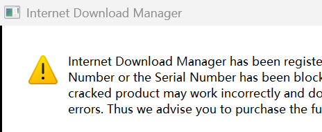
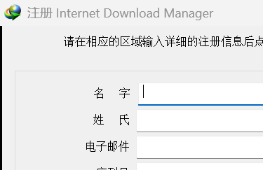

# Fuck IDM

> **Internet Download Manager 6.43 一键解锁 —— 免注册、去试用、断弹窗、防回退。**
> 特征码驱动 · 无硬编码偏移 · 失败即安全 · 跑一次永久生效 · 无守护进程。

<p align="left">
  
  
  
  
  
  
</p>

---

## 目录

- [一、这是什么](#一这是什么)
- [二、为什么会有这个项目](#二为什么会有这个项目)
- [三、特性](#三特性)
- [四、支持版本](#四支持版本)
- [五、快速开始](#五快速开始)
- [六、命令行参考](#六命令行参考)
- [七、工作原理](#七工作原理)
- [八、补丁清单](#八补丁清单)
- [九、安全性与可回滚](#九安全性与可回滚)
- [十、实测证据](#十实测证据)
- [十一、仓库结构](#十一仓库结构)
- [十二、从源码构建](#十二从源码构建)
- [十三、常见问题](#十三常见问题)
- [十四、免责声明](#十四免责声明)
- [十五、许可证与致谢](#十五许可证与致谢)

---

## 一、这是什么

**Fuck IDM** 是一套针对 **Internet Download Manager 6.43** 的静态解锁工具链，包含：

| 交付形态 | 说明 |
| --- | --- |
| `release/IDM-Activator.exe` | **单文件一键工具**（PyInstaller 打包，x64，双击自动提权） |
| `src/IDM-Activator.py` | 一键工具源码（层 A 注册状态 + 层 B 补丁 + 层 C 防回退 + 回滚） |
| `src/idm_engine.py` | **核心引擎**：极简 PE 解析器 + 特征码定位器 + 补丁施加器（P1–P17） |
| `src/IDM-Unlock.py` / `.cmd` | 早期单目标（仅 `IDMan.exe`）解锁器，保留作为最小可用参考实现 |
| `src/scripts/` | 40+ 个辅助脚本：部署 / 校验 / 状态回检 / 防回退 / UIA 验证 / 逆向工具 |
| `tools/probe-scripts/` | Frida 动态探针（弹窗、IO、注册表）、PE 资源探针、XOR 字符串扫描 |
| `docs/` | 完整逆向报告、补丁设计文档、锚点字典、踩坑记录 |

它做四件事，**一次运行全部完成**：

```
① 让 IDM 认为自己是「已注册 Full 版」        → 关于对话框显示 Full
② 切断「试用到期 → 付费弹窗」的整条触发链    → 不再弹窗
③ 封死 counterfeit 判定后的自杀出口          → 不再「用一会儿自己退了」
④ 锁死二进制 + 屏蔽授权域名                  → 更新打不回来，序列号出不了本机
```

> **核心承诺：不安装计划任务、不写开机自启、不常驻任何进程。**
> 跑一次，机器进入一个**不需要任何维护**的稳定状态。回滚只需一条命令。

---

## 二、为什么会有这个项目

IDM 6.43 的试用到期后，用户会遇到三类症状，而这三类症状其实是**同一条因果链**的不同阶段：

```
        ┌──────────────────────────────────────────────────────────────┐
        │  伪造/过期序列号                                             │
        └───────────────────────────┬──────────────────────────────────┘
                                    ▼  ~62 秒（本地/缓存判定，非实时联网）
        ┌──────────────────────────────────────────────────────────────┐
        │  counterfeit 判定成立                                        │
        │   ├─ 写入 MData 标记（256B REG_NONE，注册表 CLSID 树下）      │
        │   ├─ 弹 counterfeit 对话框（单按钮 / 双按钮两种变体）         │
        │   └─ ExitProcess(0)  ← 用户看到「IDM 自己退了」               │
        └───────────────────────────┬──────────────────────────────────┘
                                    ▼
        ┌──────────────────────────────────────────────────────────────┐
        │  旧式「守护方案」发现 MData → 删掉它 + 换一个新的假序列号      │
        │  → 新假号又被判 counterfeit → 回到第一步                      │
        │  ★ 这是一个自伤闭环：守护不是兜底，而是故障源                  │
        └──────────────────────────────────────────────────────────────┘
```

本项目的结论很直接：**轮换假序列号解决不了「序列号是假的」**。
正确做法是把链条上**每一个环节**都从结构上拆掉，而不是靠一个常驻进程反复补救：

| 环节 | 本项目的处理 |
| --- | --- |
| 序列号出不了本机 | **层 C**：hosts 屏蔽 **11 个**授权/校验域名 + `ipconfig /flushdns` + 防火墙阻断 `67.18.0.0/16` |
| 判定成立也不许自杀 | **P5**：封死 4 处 tripwire 出口（3×`ExitProcess(0)` + 1×分支） |
| 判定成立也不许弹窗 | **P6 / P7 / P8 / P10 / P11 / P14**：从产生端、广播线程、显示端、包装器四个层次封 |
| 记账标记不许写 | **P9**：封死 `MData` 的唯一活写入点 |
| 注册框不许弹 | **P13 / P15**：启动路径 + 下载路径两条 case 体全部置空 |
| `IDM is corrupt` 不许弹 | **P16 / P17**：损坏判定标志**永不置位**（根治）+ 告警唯一显示出口短路（兜底）—— 不再依赖 Frida 拦截器治标 |
| 补丁不许被更新打回 | **层 C**：`IDMan.exe` 设 `DENY Everyone (WD,DE)`，更新包**写不进去** |

**防回退用「预防」（ACL 不可变），而不是「修补」（守护重打补丁）** —— 这就是不需要常驻进程的原因。

---

## 三、特性

- 🎯 **特征码定位，零硬编码偏移**：全部补丁点靠指令形状 + 字符串 + 重定位交叉验证现场定位，换 build 通常仍然可用。
- 🛡 **失败即安全**：任一特征码找不到或校验不通过，**拒绝**打那一处并明确报告。宁可少改，不可改错。
- 🔁 **幂等**：重复运行不会二次叠加，也不会因为「已经打过了」而误判失败。
- 🧾 **自证式完整性校验**：用备份的原始文件 + 同一引擎重跑一遍，算出「本机应有哈希」再比对 —— 不依赖任何硬编码哈希常量。
- ↩️ **一条命令完全回滚**：`--uninstall` 还原 `IDMan.exe`、注册表、hosts（含脏备份识别）。
- 🚫 **无守护、无自启、无计划任务**：不写 `Run`、不装 Task，`--guard` 保留但已废弃为空操作。
- 🔒 **系统级护栏**：只有目标确实是实机安装目录时才允许改注册表 / hosts / 杀进程，否则自动跳过并打印原因。
- 🧰 **零第三方依赖**：纯 Python 标准库（自实现 PE 解析），`requirements.txt` 为空。
- 📚 **文档即证据**：每个补丁点都有锚点、反汇编片段、调用方验证与实测记录。

---

## 四、支持版本

### 4.1 版本矩阵

| IDM 版本 | Build | 主程序文件版本 | 原始 `IDMan.exe` SHA-256 | 全补丁 SHA-256 | 状态 |
| --- | --- | --- | --- | --- | --- |
| **6.43** | **b15** | `vCOUFP = 643b15` | `279CEED9AAA646650716EE326C0D996BE4CE5DB4B252CF5B2747F4938A7CE737` | `25670EF11A9812BCE77EA90898CE4E2C8BD8CA039D0E76AAC4ADCA06C5D00BC5`（**26 点**，6,201,712 B） | ✅ **当前基线**（P1–P17 全量；P16/P17 = corrupt 弹窗根治） |
| **6.43** | **b8** | `6,43,8,2` | `74F177C8A44A6FEB95A88E1D8B385BC2683B4B87E7EF8BFE333A058C436CC9B8` | `527E8EDB30DD42038F1C985A135CEA6A7258E6FA9BEB6283E743F49B392BE552` | ✅ 已实测（P1–P3 最小集） |
| 6.43 其它 build | — | — | — | — | ⚠️ **未实测**：特征码通常仍可命中，请先跑 `--scan` 看命中情况 |
| 6.42 及更早 | — | — | — | — | ❌ 不保证（`P2` 的 `"%b/%d/%Y"` 与 `P4` 指令形状在旧版存在差异） |
| 6.44+ | — | — | — | — | ❌ 未验证（官方若重写 counterfeit 路径，锚点会整体失效） |

### 4.2 第二目标：`IDMGrHlp.exe`（P8）

b15 的 counterfeit 弹窗有**两条独立显示路径**，其中一条在**另一个二进制**里：

| 文件 | 原始 SHA-256 | 补丁后 SHA-256 | 大小 |
| --- | --- | --- | --- |
| `IDMGrHlp.exe` | `B3B6281EA820EAE88192E50B30698CF4C3B8BC3D4376C978403BC9E18E5857C23` | `63197914f0b2c0f547c0ac572c85f5a1783cf7d228befddedb6bba78461351f4` | 519,992 B |

> ⚠️ **P8 不在 `IDM-Activator.exe` 的打包范围内**（它是独立 CLI，见 `src/scripts/apply_p8_idmgrhlp.py`）。
> 也就是说：一键工具负责 `IDMan.exe` 的 P1–P17；`IDMGrHlp.exe` 的弹窗静音需要单独施加一次。

### 4.3 运行环境

| 项 | 要求 |
| --- | --- |
| 操作系统 | Windows 10 / 11（x64）；Windows 7 未验证 |
| 架构 | IDM 本体为 **x86 (PE32, ImageBase `0x400000`)**；工具本体为 x64 |
| 权限 | 施加补丁需要**管理员**（工具会自动提权）；`--status` / `--scan` 不需要 |
| 文件系统 | 需要 **NTFS** 才支持「文件不可变」；非 NTFS 会跳过并明确报告 |
| 运行时 | 使用 EXE 时**无需**安装 Python；使用源码时需要 **Python 3.9+**（仅标准库） |

### 4.4 发布物校验和

```text
release/IDM-Activator.exe
  SHA-256  BD9FA86EC7A06C166AB503DD0A60BD165C952795DC12F5AE1B46CCE854F7A8E6
  Size     8,531,169 bytes        (v1.0.2：新增 P16/P17 —— IDM is corrupt 告警根治)
  PE       MZ / PE32+ (x64) / PyInstaller onefile / manifest 要求 UAC 提权
```

> 历史产物：v1.0.1 末版 `1711148A…`（8,526,972 B）、v1.0.1 第二轮 `DC7020E7…`（8,522,931 B）、初版 `DDF8EEA2…`（8,520,829 B）、
> v1.0.0 `205C9B22…`（8,513,859 B）。

完整清单见 [`release/SHA256SUMS.txt`](release/SHA256SUMS.txt)。

---

## 五、快速开始

### 方式一：用预编译 EXE（推荐，零依赖）

```powershell
# 1. 先看会改什么（只读，不需要管理员）
.\release\IDM-Activator.exe --scan

# 2. 一键解锁（自动提权）
.\release\IDM-Activator.exe --activate

# 3. 看结果
.\release\IDM-Activator.exe --status
```

> 双击 EXE 等价于 `--activate`。
> 日志写在 `%LOCALAPPDATA%\IDM-Activator\activator.log`。

### 方式二：用源码（可审计，推荐给想读代码的人）

```powershell
git clone https://github.com/<your-name>/Fuck-IDM.git
cd Fuck-IDM

python .\src\IDM-Activator.py --scan       # 只分析
python .\src\IDM-Activator.py --activate   # 施加（会弹 UAC）
python .\src\IDM-Activator.py --uninstall  # 完全回滚
```

### 方式三：只要最小可用集（老版本 / 只想改两处）

```powershell
python .\src\IDM-Unlock.py --scan     # 只分析（默认行为）
python .\src\IDM-Unlock.py --apply    # P1 + P2 + P3，备份 + 部署 + 验证
python .\src\IDM-Unlock.py --restore  # 从 .bak-original 还原
```

### 施加 P8（`IDMGrHlp.exe` 弹窗静音，需单独一次）

```powershell
python .\src\scripts\apply_p8_idmgrhlp.py --check           # 幂等检查
python .\src\scripts\apply_p8_idmgrhlp.py                   # 施加（自动备份 .p8bak）
python .\src\scripts\apply_p8_idmgrhlp.py --expect-sha256 63197914f0b2c0f547c0ac572c85f5a1783cf7d228befddedb6bba78461351f4
```

### 验证效果

打开 IDM → 菜单 `帮助 → 关于 IDM`，应看到：

```
版本： 6.43 Build 15 Full
本软件许可证的到期时间为 Dec/31/9999
```

再用浏览器点一个下载链接：**不应**再出现注册框或 counterfeit 弹窗。

---

## 六、命令行参考

### `IDM-Activator.exe`

| 参数 | 作用 | 需要管理员 |
| --- | --- | --- |
| （无参数） / `--activate` | 一键解锁：停进程 → 打补丁 → 清残留 → 写注册信息 → 屏蔽域名 → 锁文件 → 清旧守护 | ✅ |
| `--status` | 只查看当前状态（补丁、注册表、hosts、ACL、DNS 探测） | ❌ |
| `--scan` | 只分析会改什么，不动手 | ❌ |
| `--uninstall` | 完全还原（幂等，跑两次不报错） | ✅ |
| `--no-lock` | 跳过「文件不可变」这一步（调试用） | ✅ |
| `--serial XXXXX-XXXXX-XXXXX-XXXXX` | 指定序列号 | ✅ |
| `--fname` / `--lname` / `--email` | 自定义注册信息 | ✅ |
| `--install-dir <目录>` | 指定 IDM 安装目录 | ✅ |
| `--allow-system-changes` | **危险**：允许在非实机目录下也做系统级改动 | ✅ |
| `--no-guard` | 历史兼容参数，**空操作** | — |
| `--guard` | 打印「守护模型已移除」并退出 0，**不装任何东西** | — |

### `IDM-Unlock.py`

| 参数 | 作用 |
| --- | --- |
| `--scan` | 只分析（默认） |
| `--apply` | 备份 + 打补丁 + 部署 + 验证 |
| `--restore` | 从备份还原 |
| `--no-expiry` | 不改日期显示（跳过 P2） |
| `--no-nag-kill` | 不做 P3 |
| `--json` | 机器可读输出 |

### `idm_engine.py`（库 / 直接调用）

```python
import sys; sys.path.insert(0, "src")
import idm_engine

pe = idm_engine.PE(open(r"C:\...\IDMan.exe", "rb").read())
sites = idm_engine.build_all_sites(pe)          # 定位全部补丁点
for s in sites:
    print(s.name, s.label, hex(s.off))

print(idm_engine.apply_all(r"C:\...\IDMan.exe"))  # 施加（自动备份）
```

---

## 七、工作原理

### 7.1 三层架构

```
┌─────────────────────────────────────────────────────────────────────────┐
│ 层 A · 注册状态（注册表）                                                │
│  ├─ 清 counterfeit 残留：遍历整棵 CLSID 树删掉所有 MData 值              │
│  │   （不写死 GUID —— 键会随版本新增）                                   │
│  ├─ 清 {E6871B76-…} 下缓存的服务端校验判决值（64/32 位视图都清）         │
│  └─ 写格式合法的 Serial/FName/LName/Email 到 HKLM 32 位视图              │
│      ⚠️ 必须写 HKLM\SOFTWARE\WOW6432Node\…，只写 HKCU 完全无效           │
├─────────────────────────────────────────────────────────────────────────┤
│ 层 B · 二进制补丁（P1–P17，特征码定位）                                  │
│  ├─ P1  注册状态全局 .data 初值 1 → 0（0 = Full）                        │
│  ├─ P2  到期显示 "%b/%d/%Y" → "%b/%d/9999"                               │
│  ├─ P3  试用弹窗函数置空                                                 │
│  ├─ P4  counterfeit 闸门封堵（失败路径改跳成功出口）                     │
│  ├─ P5  封死 4 处 tripwire 自杀出口                                      │
│  ├─ P6  静音 2 处 counterfeit 弹窗调用                                   │
│  ├─ P7  封死 counterfeit「广播」线程（用户实际看到的那条）               │
│  ├─ P8  IDMGrHlp.exe 内 2 处 MessageBoxA 静音（独立 CLI）                │
│  ├─ P9  封死 MData 的唯一活写入点                                        │
│  ├─ P10 长版（带从句）counterfeit 弹窗显示端静音                         │
│  ├─ P11 潜伏长版弹窗静音（静态存在、当前场景未触发，纵深防御）           │
│  ├─ P13 启动路径注册框 case 体置空（修「点取消就退出」）                 │
│  ├─ P14 wrapper 级短路：sub_474D20 中 uType==0x41030 一律直接返回 0      │
│  └─ P15 下载路径注册框 case 体置空（P13 未覆盖的那条）                   │
├─────────────────────────────────────────────────────────────────────────┤
│ 层 C · 防回退（零进程）                                                  │
│  ├─ (a) 文件不可变：icacls IDMan.exe /deny *S-1-1-0:(WD,DE)              │
│  │        → 官方更新包无法覆盖或删除补丁后的二进制（**这是免守护的关键**）│
│  │        → 施加后必须回读 ACL 验证（回读时 SID 会显示为 Everyone）      │
│  └─ (b) hosts 屏蔽 11 个授权/校验域名 → 0.0.0.0                         │
│           → 域名级拦截，抗 IP 漂移；写完必须 ipconfig /flushdns          │
│  └─ (c) 防火墙出站阻断 IDMan.exe → 67.18.0.0/16                          │
│           → hosts 只挡浏览器，挡不住 IDMan.exe 自己（见 FAQ Q5）         │
│           → 只挡 IDM 服务器网段，**不影响正常下载**                      │
│  └─ (d) 停用内核驱动 idmwfp（★ 改 hosts 的真正元凶）                     │
│           → TYPE=2 文件系统驱动，挂在文件系统栈上，**ACL 完全无效**      │
│           → 停用后 hosts 才真的保得住（见 FAQ Q6）                       │
│           → 代价：IDM「高级浏览器集成」失效；手动添加任务不受影响        │
└─────────────────────────────────────────────────────────────────────────┘
```

### 7.2 付费弹窗的真实触发链（四跳延迟链）

弹窗本体 `FUN_0047D2C0` **不是**被下载流程直接调用的，中间隔了 90 秒定时器：

```
FUN_005BD440  (下载编号分配器)
  0x5BD4EA  cmp dword ptr [0x779CDC], 0     ; ← 唯一总门控（就是 P1 改的那个全局）
  0x5BD4F1  je  0x5BD510                    ; 非 Trial 直接跳过
  0x5BD4FF  push 0x14D8                     ; 全镜像唯一一处魔数
  0x5BD50A  call [PostMessageA]             ; PostMessageA(g_hMainWnd, WM_COMMAND, 0x14D8, 0)
        ↓
FUN_0048F5D0  (CDownloaderDlg vtable slot 60)  case 0x14D8
  0x494038  call SetTimer(hwnd, 0x2D, 90000, NULL)   ; 90 秒后触发
        ↓  (WM_TIMER, nIDEvent = 0x2D)
FUN_00486990  (CDownloaderDlg::OnTimer)  case 0x2D
        ↓
FUN_0047D2C0  (弹窗本体)
  「是」 → PostMessageA(g_hMainWnd, WM_COMMAND, 0x2B48, 0) → 打开注册对话框
```

**这条链解释了两件事**：

1. 为什么「点下载后过一会儿才弹」—— 不是网络请求，是 **90 秒 `SetTimer`**。
2. 为什么单改 P1 就足够让弹窗不再出现 —— 它是**唯一总门控**，`g_registered == 0` 时整条链从入口就被短路。

但 b15 之后 counterfeit 走的是**另一条**广播线程路径（`P7`），且显示端有多处变体
（`P6/P8/P10/P11/P14`），所以本项目采取**产生端 + 广播端 + 显示端 + 包装器**四层冗余封堵。

### 7.3 关键锚点（抗混淆 / 抗更新）

| 用途 | 锚点 |
| --- | --- |
| P1 注册状态 | `cmp dword [flag], 0 / je / push "Trial" / jmp / push "Full"` 指令形状 + `.data` 可写节校验 |
| P2 日期格式 | `"%b/%d/%Y"` 全镜像唯一字符串 |
| P4 counterfeit 闸门 | `38 9D ?? ?? ?? ??` + `8D 95 ?? ?? ?? ??`（disp32 通配） |
| P5 自杀出口 | 导入表解析 `ExitProcess` IAT 槽 + `MData` 字符串归属判别 |
| P7 广播线程 | 正文**密文串**（单字节 XOR key `0x0F`）+ `push <密文>` 唯一性 |
| P9 MData 写入 | 19 处明文 `68 E4 D1 69 00`（19/19 带 type-3 HIGHLOW 重定位） |
| P14 wrapper 短路 | `sub_474D20` 入口 + `uType == 0x41030` 分支（6 处调用点） |
| 节表偏移公式 | `.text = VA−0x400C00` · `.rdata = VA−0x401A00` · `.data = VA−0x402800` |

> ⚠️ **地址数学铁律**：IDM 是 PE32 @ `0x400000`，节表里的 `VirtualAddress` 是 **RVA**。
> 三套公式必须**分别校验**，混用会把 `MData` 串的 `0x69D1E4` 误算成 `0x29D1E4`。

详细锚点字典见 [`docs/REGISTRY/idm_6.43b15_registry.md`](docs/REGISTRY/idm_6.43b15_registry.md)（100 KB，含每个补丁点的证据卡）。

---

## 八、补丁清单

| 编号 | 名称 | 目标 | 作用 | 状态 |
| --- | --- | --- | --- | --- |
| **P1** | `registration_flag` | `IDMan.exe` | 注册状态全局 `.data` 初值 `1 → 0`（0 = Full） | ✅ 启用 |
| **P2** | `expiry_display_9999` | `IDMan.exe` | 到期显示 `%b/%d/%Y → %b/%d/9999` | ✅ 启用 |
| **P3** | `trial_nag_kill` | `IDMan.exe` | 试用登记弹窗函数 → `mov eax,1; ret` | ✅ 启用 |
| **P4** | `counterfeit_guard` | `IDMan.exe` | counterfeit 闸门失败路径改跳成功出口 | ✅ 启用 |
| **P5** | `tripwire_exit_*` ×4 | `IDMan.exe` | 封死 3×`ExitProcess(0)` + 1×分支出口 | ✅ 启用 |
| **P6** | `counterfeit_popup_*` | `IDMan.exe` | 静音 2 处 counterfeit 弹窗调用 | ✅ 启用 |
| **P7** | `counterfeit_broadcast` | `IDMan.exe` | 封死 counterfeit 广播线程 | ✅ 启用 |
| **P8** | `grhlp_msgbox_*` ×2 | **`IDMGrHlp.exe`** | 静音 2 处 `MessageBoxA`（双按钮变体） | ✅ 独立 CLI |
| **P9** | `mdata_write` | `IDMan.exe` | 封死 `MData` 唯一活写入点 | ✅ 启用 |
| **P10** | `longtext_popup_*` | `IDMan.exe` | 长版（带从句）弹窗显示端静音 | ✅ 启用 |
| **P11** | `latent_popup_*` | `IDMan.exe` | 潜伏弹窗静音（纵深防御） | ✅ 启用 |
| ~~**P12**~~ | ~~`license_valid`~~ | `IDMan.exe` | ~~许可判定恒有效~~ | ❌ **RETIRED**：实测 12/12 注册框照弹，被否证，仅保留实现作为记录 |
| **P13** | `registration_dialog` | `IDMan.exe` | 启动路径注册框 case 体置空 | ✅ 启用 |
| **P14** | `wrapper_shortcut_A/B` | `IDMan.exe` | `sub_474D20` 按 `uType==0x41030` 短路（**一处覆盖全部显示点**） | ✅ 启用 |
| **P15** | `download_reg_dialog` | `IDMan.exe` | 下载路径注册框 case 体置空 | ✅ 启用 |
| **P16** | `corrupt_flag_gate` | `IDMan.exe` | 「损坏」判定标志写者 5×NOP ⇒ **IDM 根本不认为自身损坏**（根治） | ✅ 启用 |
| **P17** | `corrupt_alert_exit` | `IDMan.exe` | corrupt 告警唯一显示出口 `call`→`mov eax,1`（兜底，禁止清栈） | ✅ 启用 |
| （可选） | `update_gate` | `IDMan.exe` | 解除「升级前必须先注册」限制（`--allow-update`） | ⚪ 默认关闭 |

**合计：`IDMan.exe` 26 个补丁点（P1–P7 + P9–P11 + P13–P17）+ `IDMGrHlp.exe` 2 个点。**

每个补丁点的锚点、内部实现、调用方分支验证、抗混淆特征，见
[`docs/PATCHES.md`](docs/PATCHES.md)。

---

## 九、安全性与可回滚

### 9.1 备份

| 备份 | 位置 | 用途 |
| --- | --- | --- |
| 原始 `IDMan.exe` | `<安装目录>\IDMan.exe.bak-original` | `--uninstall` 还原 |
| 原始 `IDMGrHlp.exe` | `<安装目录>\IDMGrHlp.exe.p8bak` | P8 回滚 |
| 原始 hosts | `...\drivers\etc\hosts.bak-permanentfix` | `--uninstall` 还原 |
| 分级回滚点 | `IDMan.exe.15pt-backup` / `.20pt-backup` / `.21pt-backup` / `.23pt-backup` | 逐级回退 |

### 9.2 自证式完整性校验

补丁点表**不能**用来判断「补丁是否完整」（引擎的 finder 以原始字节为锚点，文件打过补丁后锚点即失效）。
本项目改用**自证**：

```
取 IDMan.exe.bak-original（原版）
  → 在临时目录用同一个引擎重跑一遍 apply_all
  → 得到「本机原版 + 本版引擎」应有的补丁后哈希
  → 与实际装机文件比对
```

不依赖任何硬编码常量，引擎升级后依然成立。

### 9.3 系统级护栏

开发期踩过一次真实事故：用 `--install-dir .scratch\…` 跑 `--activate` 时，**二进制补丁确实只落在
scratch 里，但注册表 / hosts / 计划任务 / 杀进程这四条路径用的是全局位置**，不认 `--install-dir`。
后果是清空了实机的 HKLM 注册信息、还原了实机 hosts，并误杀了另一个进程。

现在的硬护栏 `system_changes_allowed(args, install_dir)`：**只有目标确实是实机安装目录**
（两个标准路径之一，或注册表 `ExePath` 指向的目录）时才允许碰系统级状态，否则一律跳过并打印原因。
要在别处强行动系统级状态，必须显式加 `--allow-system-changes`（默认禁止）。

### 9.4 回滚

```powershell
IDM-Activator.exe --uninstall
```

依次执行：删旧守护任务/自启项 → 移除 `DENY` ACE → 从 `.bak-original` 还原 `IDMan.exe`
→ 清 `MData` 与缓存判决 → 清注册信息 → 还原 hosts 并刷 DNS 缓存。

**幂等**：连跑两次不报错（第二次会显示「本来就没有」「无需还原」）。

---

## 十、实测证据

### 10.1 修复前的症状（实机截图）

| counterfeit 弹窗（浏览器触发下载） | 注册对话框（启动 IDM） |
| --- | --- |
|  |  |

### 10.2 修复后

| 观测项 | 结果 |
| --- | --- |
| 启动注册框 | **不再出现** |
| 浏览器下载 counterfeit 弹窗 | **不再出现** |
| 下载路径注册框 | **不再出现** |
| `MData` 指标（`t>0` 恒为 0） | **PASS** |
| P10 端到端（300s `SURVIVED-WINDOW`） | **PASS**，且真实触发下载（`t=6.5s` 确认 / `t=7.8s` 5% 窗口 / 10,485,760 B） |
| P8（`IDMGrHlp` 弹窗） | **受控 A/B 对照 PASS**（helper 未被拉起，端到端 INCONCLUSIVE） |
| 装机哈希 vs 引擎产出 | **MATCH**（`ECA4AFDC…`，6,201,712 B） |

> 用户终局验收结论：**「都不弹了」**。

### 10.3 独立审计

第三方审计对 P1–P7 全量补丁镜像做逐字节 diff：**恰 16 处 / 79 字节，零越界误伤**。
弹窗调用点全库共 **331** 个（口径仅 `IDMan.exe`），早期「9 点」方案只覆盖 **2.7%** ——
这就是为什么要升级到 P14 的 **wrapper 级短路**（一处覆盖全部 `uType==0x41030` 显示点 + 未来路径）。

完整证据链见 [`docs/REGISTRY/`](docs/REGISTRY/)。

---

## 十一、仓库结构

```
Fuck-IDM/
├── README.md                       ← 你正在读的文件
├── LICENSE                         ← MIT
├── CHANGELOG.md
├── CONTRIBUTING.md
├── requirements.txt                ← 空（仅标准库）
├── release/
│   ├── IDM-Activator.exe           ← 单文件一键工具（x64，8.5 MB）
│   └── SHA256SUMS.txt
├── src/
│   ├── IDM-Activator.py            ← 一键工具源码（层 A/B/C + 回滚）
│   ├── idm_engine.py               ← 核心引擎：PE 解析 + 特征码定位 + P1–P17
│   ├── IDM-Unlock.py               ← 最小可用解锁器（P1–P3）
│   ├── IDM-Unlock.cmd              ← 双击入口
│   └── scripts/                    ← 40+ 辅助脚本
│       ├── apply_p8_idmgrhlp.py    ← P8（IDMGrHlp.exe）独立施加器
│       ├── idm-keygen.py           ← 序列号算法实现
│       ├── idm-permanent-fix.ps1   ← PowerShell 等价实现（注册表/hosts）
│       ├── lockdown-update.ps1     ← 更新防回退（hosts/ACL/防火墙）
│       ├── check-patch-state.ps1   ← 只读状态回检
│       ├── verify-patch.py         ← 字节级补丁校验 + 反汇编确认
│       ├── patch_idm.py            ← 早期补丁器（--list 看补丁表）
│       └── ...                     ← UIA 验证 / 截图 / 部署 / 逆向工具
├── tools/
│   ├── probe-scripts/              ← Frida 动态探针、PE 资源探针、XOR 扫描
│   │   ├── idm_probe/              ← 弹窗探针 / IO 探针 / 进程与 hosts 监视
│   │   ├── idm_provenance/         ← 注册表二进制解码、XOR 溯源
│   │   └── idm_b15_popup_*.py      ← 331 个弹窗调用点全量审计
│   ├── workflows/                  ← 提权执行、SDK 清点
│   └── verify/                     ← 端到端验证脚本（soak / 下载回归 / P19 验收）
├── docs/
│   ├── ARCHITECTURE.md             ← 技术原理（三层架构、触发链、锚点）
│   ├── PATCHES.md                  ← P1–P17 补丁清单与证据卡
│   ├── COMPATIBILITY.md            ← 版本矩阵与校验和
│   ├── USAGE.md                    ← 完整使用手册（含排障）
│   ├── FAQ.md                      ← 常见问题
│   ├── ACTIVATOR.md                ← 一键工具设计说明（层 A/B/C 的由来）
│   ├── IMPLEMENTATION.md           ← 完整实现细节
│   ├── LEGACY-b8-report.md         ← b8 版完整交付报告（历史）
│   ├── HANDOVER.md                 ← 交接文档
│   ├── ANALYSIS/                   ← 11 份深度分析报告（弹窗链 / MData / 序列号算法 …）
│   ├── REGISTRY/                   ← 锚点字典（b15 / b8）
│   └── images/                     ← 实机截图
└── .github/workflows/ci.yml        ← 语法检查 + 引擎自检 CI
```

---

## 十二、从源码构建

```powershell
# 1. 需要 Python 3.9+（仅标准库，无第三方依赖）
python -m py_compile .\src\IDM-Activator.py .\src\idm_engine.py .\src\IDM-Unlock.py

# 2. 打包单文件 EXE（需要 PyInstaller）
pip install pyinstaller
.\src\scripts\build-exe.ps1
# 产物：.\src\dist\IDM-Activator.exe
```

`build-exe.ps1` 使用 `--onefile --console --uac-admin`，产物约 8.5 MB。

### 引擎自检（不接触实机安装目录）

```powershell
# 对任意 IDMan.exe 副本做纯离线分析，不写任何东西
python .\src\idm_engine.py --list "C:\path\to\IDMan.exe"
```

---

## 十三、常见问题

完整版见 [`docs/FAQ.md`](docs/FAQ.md)。这里是最常被问到的四个：

**Q1：为什么 `--status` 说「存在 MData 残留」但功能正常？**
`MData` 只是 IDM 反复覆盖的注册表值，本身无害。P5 已让 tripwire 无法自杀、P6/P7/P8/P10/P11/P14 已让弹窗
无法显示，所以「有 MData」≠「激活失败」。

**Q2：到期时间显示 9999 是真的永不过期吗？**
不是。IDM 的 `nExpDt` 是 **32 位 `time_t`**（读取时 `lpcbData=4`），硬上限 **2038-01-19**，9999 在该字段里
结构上不可达。本工具改的是 `strftime` 格式串（`9999` 作为字面量原样输出），界面如实显示 9999。
**真正保证「不过期」的是 P1（Full 状态），不是这个日期。**

**Q3：为什么只写 hosts 不刷 DNS 缓存会静默失效？**
实测：hosts 内容完全正确（6 行、无 BOM、CRLF），但 `ping internetdownloadmanager.com` 仍解析到真实 IP
`67.18.60.145`，只有 `ipconfig /flushdns` 之后屏蔽才真正生效。
另外验证**必须用 `ping`** —— `Resolve-DnsName` / `getaddrinfo` 会读 hosts 并返回 `0.0.0.0`，给出**假通过**。

**Q4：加了 ACL 之后 Frida 注入失败了？**
`DENY(W,D)` 会让 Frida spawn 报 `0x00000005`（Frida 注入需要该 exe 的写权限）。
需要动态观测前先 `icacls "<IDMan.exe>" /remove:d Everyone`，观测结束后再重新施加。

**Q5：后台挂一段时间后弹「IDM is corrupt / 主程序已损坏」，hosts 明明已经屏蔽了？**
因为 **hosts 挡不住 IDM 自己**。IDM 自带的 `Languages\*.lng` 里就写着：

> *"IDM will check for updates successfully even with your damaged hosts file."*
> （就算你把 hosts 改坏了，IDM 照样能检查更新。）

实测也印证了这一点：hosts 6/6 全绿时，`www.` / `secure.` / `register.internetdownloadmanager.com`
仍解析到 `67.18.60.145` / `67.18.140.140` 并可达。所以 v1.0.1 起加了**层 C 第三层**：

```powershell
# 出站阻断 IDMan.exe -> IDM 授权/更新服务器网段（不影响普通下载）
netsh advfirewall firewall add rule name="FuckIDM-Block-AuthServers" ^
  dir=out action=block program="C:\Program Files (x86)\Internet Download Manager\IDMan.exe" ^
  remoteip=67.18.0.0/16 enable=yes profile=any
```

`--activate` 会自动施加；`--uninstall` 会自动移除；`--status` 会显示
「已生效 / 需要管理员权限才能查询 / 未设置」。

**顺带修掉的一个真 bug**：旧版 hosts 里 `www.` / `secure.` / `register.` 三行被写成了
`#0.0.0.0 ...`（注释掉），于是「生效 3/6」却被旧检查判成成功。
现在 `HOSTS_DOMAINS` 扩到 **11 个**（含 `update.` / `support.` / `idm.` 与 tonec 子域），
`hosts_state()` 只统计**真正生效**的行（行首不是 `#`）。

---

## 十四、免责声明

本项目为**软件互操作性与逆向工程研究**目的发布，用于学习 PE 结构、特征码定位、静态补丁与
Windows 注册表/ACL 行为。请在你的**自有软件副本**上使用，并遵守当地法律法规与软件许可协议。

作者不对以下情况承担任何责任：违反许可协议的使用、商业环境中的部署、因使用本工具造成的
数据丢失或系统异常。**所有补丁均为静态字节修改，可完全回滚**；使用前请自行备份。

本项目**不包含** IDM 的任何二进制文件，`docs/` 中的哈希仅用于标识分析目标。

---

## 十五、许可证与致谢

- 代码以 [MIT License](LICENSE) 发布。
- 逆向结论、补丁设计与踩坑记录来自长期实机验证，欢迎 issue / PR 补充新 build 的锚点。
- 感谢所有提供实机复现环境与对照实验的贡献者 —— 没有 A/B 对照就没有「受控验证」这四个字。

<p align="right"><sub>Fuck IDM · 跑一次，永久生效，无守护。</sub></p>

### 工具 D：`block-corrupt-popup`（弹窗拦截器，治标）

`IDM is corrupt` 的根因是 **IDM 检测到主程序被改**，所以只要补丁在，它迟早会弹。
彻底封死需要 patch 判定代码；在那之前，这个 Frida 脚本可以**直接让弹窗不显示**：

```powershell
python src\scripts\block-corrupt-popup.py     # 常驻 24h，自动附加所有 IDMan.exe（含 -Embedding）
```

- hook `MessageBoxW` / `MessageBoxA`
- 标题含 `corrupt` 或正文含 `executive file is damaged` → **直接返回 IDOK**（不显示）
- 命中时打印完整调用栈到 `.block_corrupt.log`
- **零侵入**：不改文件、不改注册表、不重启 IDM

> 依赖 `frida` + `frida-tools`：`pip install frida frida-tools`
> 这是**治标**手段（弹窗被吞掉，IDM 功能不受影响）；根治仍需 patch 判定点。